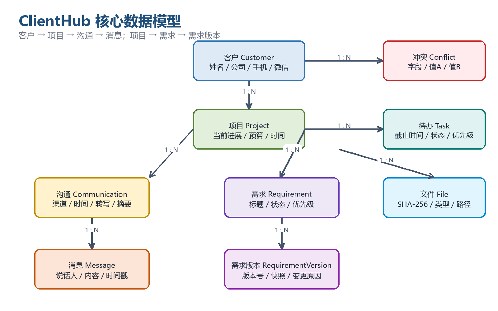
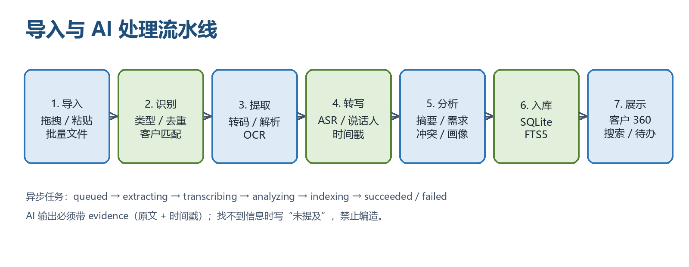
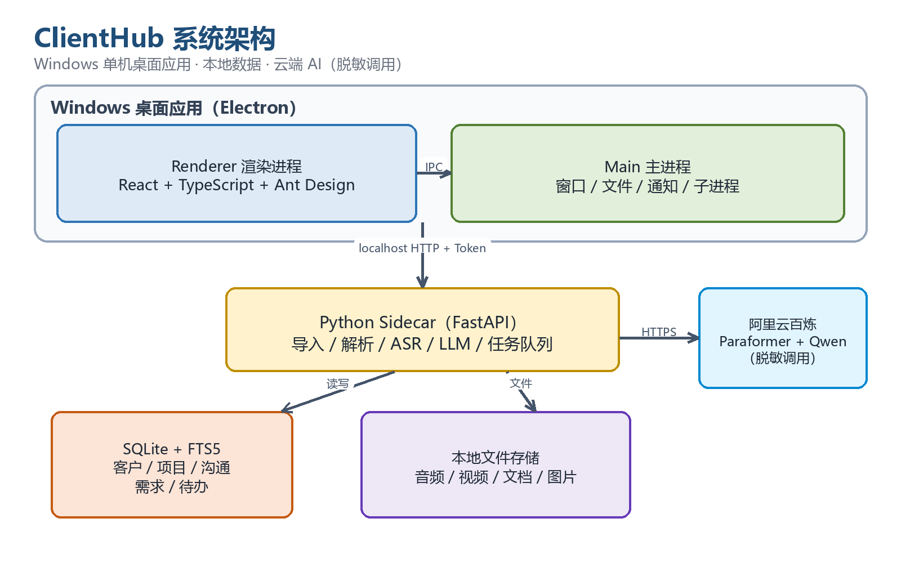

# 客户信息聚合工作台（ClientHub）产品需求文档

> 文档版本：V1.0  
> 文档日期：2026-10-28  
> 文档状态：需求基线（待评审）  
> 产品形态：Windows 单机桌面应用 / 单用户  
> 目标读者：老板（产品负责人）、开发实现人员、验收人员

> 2026-11-01 实现补充：用户再次确认保持单机单用户，不做账号与多人协作；自动说话人分离本轮不实现。新增长音频切片并发 ASR、扫描 PDF/图片本地 OCR、旧 Office 与 PPT 解析，系统通知沿用第 6.11.3 节的 09:00 和默认免打扰规则。具体支持格式、限制与验证记录见 HANDOFF.md 的当日记录；应用退出后不发送系统通知，启动后补充到期提醒。

---

## 0. 文档信息与决策摘要

### 0.1 文档信息

| 项目 | 内容 |
|---|---|
| 产品名称 | 客户信息聚合工作台（内部代号：ClientHub） |
| 产品定位 | 面向单人多项目软件公司的本地客户情报工作台 |
| 使用者 | 老板本人（单用户，不做多人协作） |
| 部署形态 | Windows 10/11 64 位桌面应用，数据保存在本机 |
| AI 方式 | 云端 API（阿里云百炼/通义），本地做脱敏；开发期先用模拟数据 |
| 第一版周期 | 两周以内 |
| 交付形态 | 一键安装包（NSIS），内置运行依赖 |
| 文档版本 | V1.0 |
| 编制日期 | 2026-10-28 |

### 0.2 已确认的关键决策

| 决策项 | 结论 |
|---|---|
| 产品边界 | 只给老板本人使用，不做多租户、不做多人权限 |
| 数据存储 | 本机存储，不做云同步、不做自动备份（提供手动导出） |
| 客户单位 | 以个人客户为主，一条记录对应一个具体联系人；公司名作为可选字段 |
| 客户联系人 | 不做多联系人管理，客户档案内保留主要联系方式即可 |
| 项目模型 | 一个客户下可挂多个项目/商机，每个项目独立记录需求、进展与沟通 |
| 阶段模型 | 不设固定销售阶段，使用自由文本“当前进展”+ 标签 + AI 建议 |
| 微信接入 | 后续由老板提供本地数据库提取方案；第一版先做聊天文件、截图、粘贴导入 |
| 通话接入 | 录音文件导入（mp3/m4a/wav/amr/mp4 等），不做拨号与呼叫中心 |
| 邮件接入 | 支持 .eml 导入 + IMAP 单账号自动同步（两项都做） |
| 文件类型 | 音频、视频、PDF、Word、Excel、PPT、图片、压缩包、聊天记录文件 |
| 视频处理 | 只提取音轨转写，不做画面关键帧 OCR |
| AI 供应商 | 阿里云百炼/通义（Paraformer 语音识别 + Qwen 大模型），代码做供应商适配层 |
| API Key | 开发期先用模拟数据，真实 Key 后续提供 |
| 数据规模 | 小规模：1,000 个以内客户，每月几十小时通话 |
| 安全要求 | 本地使用，按基础企业级处理；云端调用前脱敏四类信息 |
| 费用控制 | 不设月度上限 |
| 回复能力 | 不直接回复客户，不做微信/邮件发送 |
| 日报/周报 | 不做 |
| 历史迁移 | 暂不做批量历史迁移，后续按需补 |
| 技术栈 | Electron + React + TypeScript + SQLite + Python 子进程 |
| 开发方式 | 由 AI（我）直接实现，PRD 作为实现依据 |

---

## 1. 背景与问题

### 1.1 现状

公司目前的客户信息分散在多个渠道：

- **电话沟通**：通话录音保存在手机或录音笔里，听完就过去了，无法快速检索；
- **个人微信**：聊天记录、语音、图片、文件混在聊天窗口里，历史消息翻找困难；
- **邮件**：需求、报价、合同附件散落在邮箱不同文件夹；
- **各种文件**：客户发来的 PDF、Word、Excel、PPT、图片、压缩包、视频，没有统一归档；
- **记忆依赖**：客户“聊到哪一步、需求是什么、预算多少、谁拍板”，大量依赖老板个人记忆。

结果是：客户越多，信息越散；时间越久，越难还原当时说过什么。老板需要一个地方，把这些信息自动聚合到“客户”这个主体上，并且能一眼看懂客户的历史、需求、进展和下一步。

### 1.2 痛点拆解

| 痛点 | 典型场景 | 造成的影响 | 产品应对 |
|---|---|---|---|
| 信息零散 | 电话在手机、微信在电脑、邮件在邮箱 | 找一个客户的完整历史要翻三四个地方 | 多来源统一导入，自动归到客户时间线 |
| 记录成本高 | 1 小时通话，整理纪要要半小时 | 不愿意记，记录缺失 | 自动转写 + 结构化摘要，人工只做校对 |
| 需求易丢失 | 客户在微信里随口说“还要加个审批” | 需求遗漏、返工、报价漏项 | 从聊天/通话中自动抽取需求条目 |
| 进展不清晰 | 客户同时谈多个项目 | 记不清哪个客户到哪一步 | 客户 360 + 项目进度 + AI 阶段建议 |
| 信息冲突 | 邮件说预算 10 万，通话说 8 万 | 报价和方案依据错误 | 冲突检测，保留来源与时间 |
| 无法提问 | 想找“哪些客户提过小程序” | 只能逐个翻记录 | 跨客户自然语言问答 + 原文引用 |
| 跟进遗漏 | 客户说“下周再联系” | 忙着忙着忘了 | 从沟通中生成待办 + Windows 提醒 |

### 1.3 产品机会

- **本地桌面 + 云端 AI**：数据存在本机，重活交给云端模型，成本和实现复杂度都可控；
- **以客户为中心，而不是以渠道为中心**：所有渠道最终都归到“客户 → 项目 → 沟通 → 需求”四层结构；
- **AI 做粗加工，人做最终判断**：转写、摘要、抽取由 AI 完成，关键结论必须能点回原文；
- **先解决老板一个人的问题**：不做大而全的 CRM，先把“看得全、找得到、记得住、跟得上”做好。

---

## 2. 产品定位与目标

### 2.1 一句话定位

**把电话、微信、邮件、文件里的客户信息，自动聚合成一个客户 360 工作台；让老板在 5 秒内知道这个客户是谁、聊过什么、需求是什么、现在到哪一步、下一步该做什么。**

### 2.2 产品目标

| 目标 | 衡量方式 |
|---|---|
| 找得到 | 输入客户姓名/公司/手机号，5 秒内看到完整时间线 |
| 看得懂 | 每次通话/聊天自动生成结构化摘要，关键信息一屏读完 |
| 记得住 | 需求条目化，支持状态、优先级、变更历史 |
| 跟得上 | 自动生成下一步待办，到期在 Windows 桌面提醒 |
| 问得清 | 支持跨客户自然语言提问，答案带原文引用 |
| 不添乱 | 识别不了的资料进入“待归档”，不丢数据、不强行归类 |

### 2.3 产品非目标（当前版本明确不做）

- ❌ 多用户、团队协作、角色权限、审批流；
- ❌ 多租户 SaaS、对外销售；
- ❌ 直接给客户发微信/邮件、自动回复；
- ❌ 电话拨号、呼叫中心、实时录音；
- ❌ 企业微信会话存档、钉钉/飞书接入；
- ❌ 手机 App、移动端网页；
- ❌ 每日/每周客户简报；
- ❌ 云同步、多设备、自动备份；
- ❌ 批量历史数据迁移（后续可扩展）；
- ❌ 复杂的安全合规体系（等保、国密、审计审批）；
- ❌ 视频画面关键帧 OCR（只做音轨转写）；
- ❌ 固定销售阶段枚举与漏斗报表（用自由文本进展 + 标签代替）。

---

## 3. 用户与使用场景

### 3.1 用户画像

| 维度 | 描述 |
|---|---|
| 身份 | 软件公司老板/经营者 |
| 使用环境 | Windows 10/11 电脑，日常办公；手机负责通话和微信 |
| 工作方式 | 同时跟进多个客户和项目；电话、微信、邮件混合沟通 |
| 技术能力 | 普通办公软件水平，不希望配置复杂系统；能接受一次性安装和 API Key 配置 |
| 核心诉求 | 不遗漏客户信息、快速回顾历史、看清需求和进展、知道下一步做什么 |
| 使用频率 | 每天多次打开；通话后、微信沟通后、报价前、复盘时 |

### 3.2 核心场景

#### 场景 A：通话结束后 5 分钟完成归档

1. 手机通话录音导出到电脑；
2. 把录音文件拖进工作台；
3. 系统自动识别客户（或进入待归档让老板选择）；
4. 自动转写、区分“我”和“客户”、生成结构化通话纪要；
5. 老板扫一眼纪要，修改个别错字；
6. 把“下一步动作”一键加入待办。

#### 场景 B：微信聊天整理成可读的对话

1. 老板导出微信聊天记录（TXT/HTML/JSON），或直接复制一段聊天，或上传截图；
2. 工作台解析成按时间排列的对话，区分双方；
3. 自动提炼关键问答、需求、承诺；
4. 需求进入对应项目的需求清单；
5. 聊天中的图片、语音、文件自动归档。

#### 场景 C：见客户前 3 分钟快速复盘

1. 搜索客户姓名；
2. 打开客户 360：
   - 顶部看到客户画像、当前进展、最近联系时间；
   - 中间看到跨渠道时间线；
   - 右侧看到未关闭需求、冲突提醒、待办；
3. 点开任意摘要，能跳到原文/录音时间点核对。

#### 场景 D：跨客户找需求

1. 在 AI 问答里问：“哪些客户提过小程序开发？预算大概多少？”
2. AI 返回客户列表、需求摘要、预算区间和原文引用；
3. 点引用直接打开对应沟通记录。

#### 场景 E：邮件自动归档

1. 在设置中配置 IMAP 邮箱；
2. 工作台定时同步客户邮件；
3. 自动匹配客户、解析正文和附件；
4. 邮件进入客户时间线，附件进入文件库。

---

## 4. 产品范围与版本规划

### 4.1 版本策略

| 版本 | 时间 | 目标 | 核心内容 |
|---|---|---|---|
| V0.1 内部原型 | 第 1 周 | 跑通最小链路 | 桌面壳、SQLite、导入中心、模拟 AI、通话转写界面 |
| V1.0 两周 MVP | 第 2 周 | 三条主流程可用 | 多来源归档、通话转写+摘要、聊天解析、客户/项目基础、客户 360 基础、邮件 .eml + IMAP、待归档、基础搜索 |
| V1.1 增强版 | 第 3–4 周 | 从“能看”到“好用” | 需求清单与变更历史、冲突检测、客户画像、待办提醒、跨客户 AI 问答、导出 PDF/Excel、通用助手 |
| V2.0 后续 | 按需 | 自动化与规模化 | 微信数据库自动提取、IMAP OAuth、批量历史迁移、更多分析报表 |

### 4.2 功能范围矩阵

| 模块 | V1.0（两周 MVP） | V1.1 | V2.0 |
|---|---|---|---|
| 多来源导入 | ✅ 拖拽、粘贴、批量文件 | 优化大批量体验 | 文件夹监控 |
| 音频/视频转写 | ✅ 音频+视频音轨 | 方言/噪声优化 | 实时转写 |
| 通话摘要 | ✅ 固定模板 | 自定义模板 | 多模板 |
| 微信聊天解析 | ✅ 文件/粘贴/截图 | 更丰富的导出格式 | 本地数据库自动提取 |
| 邮件 | ✅ .eml + IMAP | OAuth、更多邮箱 | 邮件规则引擎 |
| 客户/项目管理 | ✅ 基础 CRUD | 批量操作 | 客户合并建议 |
| 客户 360 | ✅ 基础时间线 | 完整画像与冲突 | 高级分析 |
| 需求管理 | ✅ 基础条目 | 版本历史、状态流转 | 报价关联 |
| 客户画像 | ⏳ 基础摘要 | ✅ 自动画像 | 行业洞察 |
| 冲突检测 | ⏳ 规则预留 | ✅ 预算/时间/需求冲突 | 智能冲突推理 |
| 待办提醒 | ✅ 基础待办 | ✅ Windows 通知 | 日历同步 |
| 搜索 | ✅ 关键词 | ✅ 语义检索 | 混合检索优化 |
| AI 问答 | ⏳ 接口预留 | ✅ 跨客户问答 | 多轮分析 |
| 通用助手 | ⏳ | ✅ 独立页签 | 工具调用 |
| 导出 | ⏳ | ✅ PDF/Excel | 自定义模板 |
| 安装包 | ✅ 一键安装 | 自动更新 | 企业分发 |

> 说明：⏳ 表示 V1.0 保留数据结构和入口，但功能在 V1.1 完整交付。

### 4.3 两周 MVP 验收边界

**必须完成（P0）：**

1. Windows 安装包可安装、可启动、可卸载；
2. 拖拽/批量导入音频、视频、PDF、Word、Excel、PPT、图片、压缩包；
3. 音频/视频自动转写，区分“我/客户”，带时间戳；
4. 通话按固定模板生成结构化摘要，空字段显示“未提及”；
5. 微信聊天记录（TXT/HTML/JSON）、粘贴文本、截图导入并解析为时间线；
6. 客户/项目/沟通/需求/待办的基础数据模型与增删改查；
7. 客户列表、客户 360 基础页、待归档页；
8. 客户自动匹配（手机号/邮箱/微信号精确匹配）与人工确认；
9. .eml 导入 + IMAP 单账号同步（需老板提供邮箱授权码）；
10. 基础关键词搜索；
11. 所有 AI 调用可切换“模拟模式/真实模式”；
12. 数据全部保存在本机，卸载不删除用户数据（给出提示）。

**应该完成（P1，时间允许则做）：**

- 需求条目从沟通中自动抽取；
- 客户画像基础版；
- 冲突检测规则；
- 导出客户档案 PDF / 需求清单 Excel；
- Windows 待办通知。

**可以延后（P2）：**

- 跨客户 AI 问答；
- 通用 AI 助手；
- 微信本地数据库自动提取；
- 批量历史迁移；
- 高级分析报表。

---

## 5. 核心概念与数据模型

### 5.1 核心概念

| 概念 | 定义 | 示例 |
|---|---|---|
| 客户 Customer | 一个具体联系人/个人客户；公司名作为可选字段 | 张三（某某科技有限公司） |
| 项目 Project | 客户下的一个商机或交付项目 | 张三-小程序商城项目 |
| 沟通 Communication | 一次通话、一段聊天、一封邮件或一次批量文件导入 | 2026-10-20 与张三通话 35 分钟 |
| 消息 Message | 沟通中的单条消息或转写片段 | 客户说：“预算大概 8 万” |
| 需求 Requirement | 从沟通中抽取的可跟踪需求条目 | 需要微信支付和会员积分 |
| 需求版本 RequirementVersion | 需求每次变更的历史快照 | v1 预算 8 万 → v2 预算 10 万 |
| 待办 Task | 下一步动作 | 周五前发报价单 |
| 文件 File | 原始音频/视频/文档/图片等 | 通话录音.m4a |
| AI 任务 AI Job | 转写、摘要、抽取、索引等异步任务 | 转写任务 #1024 |
| 冲突 Conflict | 不同来源对同一关键信息的不一致 | 邮件预算 10 万 vs 通话 8 万 |

### 5.2 实体关系



```text
Customer 1 ─── N Project
Customer 1 ─── N Communication
Project  1 ─── N Communication
Communication 1 ─── N Message
Project  1 ─── N Requirement
Requirement 1 ─── N RequirementVersion
Customer 1 ─── N Task
Project  1 ─── N Task
Communication 1 ─── N File
Customer 1 ─── N Conflict
```

### 5.3 关键数据表（逻辑设计）

#### customers（客户）

| 字段 | 类型 | 必填 | 说明 |
|---|---|---|---|
| id | TEXT/UUID | 是 | 主键 |
| name | TEXT | 是 | 客户姓名/称呼 |
| company | TEXT | 否 | 所属公司 |
| phone | TEXT | 否 | 手机号（归一化 +86） |
| wechat_id | TEXT | 否 | 微信号/微信唯一标识 |
| wechat_nickname | TEXT | 否 | 微信昵称 |
| email | TEXT | 否 | 邮箱（小写归一化） |
| source | TEXT | 否 | 客户来源：转介绍/微信/电话/邮件/其他 |
| tags | TEXT(JSON) | 否 | 标签数组，如 ["重点客户","制造业"] |
| profile_json | TEXT(JSON) | 否 | AI 生成的客户画像 |
| notes | TEXT | 否 | 人工备注 |
| created_at | DATETIME | 是 | 创建时间 |
| updated_at | DATETIME | 是 | 更新时间 |
| last_contact_at | DATETIME | 否 | 最后沟通时间（冗余字段） |
| archived | INTEGER | 是 | 0/1 是否归档 |

#### projects（项目/商机）

| 字段 | 类型 | 必填 | 说明 |
|---|---|---|---|
| id | TEXT/UUID | 是 | 主键 |
| customer_id | TEXT | 是 | 所属客户 |
| name | TEXT | 是 | 项目名称 |
| description | TEXT | 否 | 项目描述 |
| progress_text | TEXT | 否 | 当前进展自由文本，如“已报价，等客户内部审批” |
| budget_text | TEXT | 否 | 预算原文，如“8–10 万” |
| timeline_text | TEXT | 否 | 时间要求原文 |
| stage_tag | TEXT | 否 | 可选标签，如“报价中” |
| status | TEXT | 是 | active / won / lost / paused / archived |
| created_at | DATETIME | 是 | 创建时间 |
| updated_at | DATETIME | 是 | 更新时间 |

#### communications（沟通记录）

| 字段 | 类型 | 必填 | 说明 |
|---|---|---|---|
| id | TEXT/UUID | 是 | 主键 |
| customer_id | TEXT | 否 | 关联客户；待归档时为空 |
| project_id | TEXT | 否 | 关联项目 |
| channel | TEXT | 是 | call / wechat / email / file / paste |
| direction | TEXT | 否 | inbound / outbound / unknown |
| title | TEXT | 否 | 标题，如“与张三通话 35 分钟” |
| occurred_at | DATETIME | 否 | 沟通发生时间 |
| source_file_id | TEXT | 否 | 原始文件 |
| raw_text | TEXT | 否 | 原始文本（聊天导出/粘贴） |
| transcript | TEXT | 否 | 转写全文（带时间戳的 JSON 也可） |
| summary_json | TEXT(JSON) | 否 | 结构化摘要 |
| analysis_status | TEXT | 是 | pending / processing / done / failed |
| match_status | TEXT | 是 | matched / unmatched / pending |
| created_at | DATETIME | 是 | 创建时间 |
| updated_at | DATETIME | 是 | 更新时间 |

#### messages（消息/转写片段）

| 字段 | 类型 | 必填 | 说明 |
|---|---|---|---|
| id | TEXT/UUID | 是 | 主键 |
| communication_id | TEXT | 是 | 所属沟通 |
| speaker | TEXT | 否 | 说话人标识 |
| speaker_role | TEXT | 否 | me / customer / unknown |
| content | TEXT | 是 | 消息内容/转写文本 |
| start_ms | INTEGER | 否 | 音频起始毫秒 |
| end_ms | INTEGER | 否 | 音频结束毫秒 |
| message_type | TEXT | 是 | text / image / voice / file / system |
| file_id | TEXT | 否 | 关联附件 |
| created_at | DATETIME | 是 | 创建时间 |

#### requirements（需求条目）

| 字段 | 类型 | 必填 | 说明 |
|---|---|---|---|
| id | TEXT/UUID | 是 | 主键 |
| project_id | TEXT | 是 | 所属项目 |
| title | TEXT | 是 | 需求标题 |
| description | TEXT | 否 | 需求详情 |
| status | TEXT | 是 | pending / confirmed / quoted / developing / done / cancelled |
| priority | TEXT | 是 | P0 / P1 / P2 / P3 |
| source_communication_id | TEXT | 否 | 来源沟通 |
| source_excerpt | TEXT | 否 | 原文摘录 |
| due_text | TEXT | 否 | 时间要求原文 |
| current_version | INTEGER | 是 | 当前版本号 |
| created_at | DATETIME | 是 | 创建时间 |
| updated_at | DATETIME | 是 | 更新时间 |

#### requirement_versions（需求版本）

| 字段 | 类型 | 必填 | 说明 |
|---|---|---|---|
| id | TEXT/UUID | 是 | 主键 |
| requirement_id | TEXT | 是 | 所属需求 |
| version | INTEGER | 是 | 版本号 |
| content | TEXT(JSON) | 是 | 该版本的完整快照 |
| change_reason | TEXT | 否 | 变更原因 |
| source_communication_id | TEXT | 否 | 触发变更的沟通 |
| created_at | DATETIME | 是 | 创建时间 |

#### tasks（待办）

| 字段 | 类型 | 必填 | 说明 |
|---|---|---|---|
| id | TEXT/UUID | 是 | 主键 |
| customer_id | TEXT | 否 | 关联客户 |
| project_id | TEXT | 否 | 关联项目 |
| title | TEXT | 是 | 待办标题 |
| description | TEXT | 否 | 详情 |
| due_at | DATETIME | 否 | 到期时间 |
| priority | TEXT | 是 | P0–P3 |
| status | TEXT | 是 | todo / doing / done / cancelled |
| source_communication_id | TEXT | 否 | 来源沟通 |
| created_at | DATETIME | 是 | 创建时间 |
| completed_at | DATETIME | 否 | 完成时间 |

#### files（文件）

| 字段 | 类型 | 必填 | 说明 |
|---|---|---|---|
| id | TEXT/UUID | 是 | 主键 |
| sha256 | TEXT | 是 | 内容哈希，用于去重 |
| original_name | TEXT | 是 | 原始文件名 |
| stored_path | TEXT | 是 | 本地存储相对路径 |
| mime_type | TEXT | 否 | 文件类型 |
| size_bytes | INTEGER | 是 | 文件大小 |
| kind | TEXT | 是 | audio / video / pdf / word / excel / ppt / image / archive / chat / other |
| created_at | DATETIME | 是 | 导入时间 |

#### ai_jobs（AI 任务）

| 字段 | 类型 | 必填 | 说明 |
|---|---|---|---|
| id | TEXT/UUID | 是 | 主键 |
| type | TEXT | 是 | transcribe / summarize / extract_requirements / profile / embed / qa |
| target_type | TEXT | 是 | communication / project / customer |
| target_id | TEXT | 是 | 目标记录 ID |
| status | TEXT | 是 | queued / running / succeeded / failed / cancelled |
| progress | INTEGER | 是 | 0–100 |
| provider | TEXT | 否 | mock / dashscope |
| error_message | TEXT | 否 | 失败原因 |
| retry_count | INTEGER | 是 | 重试次数 |
| created_at | DATETIME | 是 | 创建时间 |
| started_at | DATETIME | 否 | 开始时间 |
| finished_at | DATETIME | 否 | 结束时间 |

#### conflicts（冲突）

| 字段 | 类型 | 必填 | 说明 |
|---|---|---|---|
| id | TEXT/UUID | 是 | 主键 |
| customer_id | TEXT | 是 | 客户 |
| project_id | TEXT | 否 | 项目 |
| field_name | TEXT | 是 | 冲突字段：budget / timeline / requirement / decision_maker |
| value_a | TEXT | 是 | 值 A |
| source_a_id | TEXT | 是 | 来源 A 的沟通 ID |
| value_b | TEXT | 是 | 值 B |
| source_b_id | TEXT | 是 | 来源 B 的沟通 ID |
| status | TEXT | 是 | open / resolved / ignored |
| resolution_note | TEXT | 否 | 处理说明 |
| created_at | DATETIME | 是 | 创建时间 |

### 5.4 客户身份匹配规则

| 情况 | 处理方式 |
|---|---|
| 手机号完全一致（归一化后） | 自动匹配到唯一客户 |
| 邮箱完全一致（小写归一化） | 自动匹配到唯一客户 |
| 微信号/微信唯一标识完全一致 | 自动匹配到唯一客户 |
| 多个字段匹配到不同客户 | 进入“待确认”，列出候选，由老板选择 |
| 只匹配到姓名/公司相似 | 仅作为候选建议，不自动合并 |
| 完全无匹配 | 弹窗询问“新建客户 / 选择已有客户 / 放入待归档” |
| 批量导入 | 每条记录独立匹配；无法匹配的统一进入待归档 |
| 合并客户 | 手动触发；保留主记录，迁移项目/沟通/需求/待办，记录合并日志 |

### 5.5 阶段模型

- 不设固定枚举，避免把老板的实际流程框死；
- `projects.progress_text` 保存自由文本，例如：“已发方案，客户内部走预算审批，预计下周三反馈”；
- `projects.stage_tag` 可选，用于筛选，例如：线索、需求中、报价中、谈判中、已签约、交付中、已结束；
- AI 在每次新沟通后给出“进展建议”，老板一键采纳或忽略；
- 客户列表可按 `last_contact_at`、`stage_tag`、标签筛选，不强制漏斗。

### 5.6 需求状态与优先级

| 状态 | 含义 |
|---|---|
| 待确认 | AI 抽取或人工记录，尚未与客户确认 |
| 已确认 | 客户明确认可 |
| 已报价 | 已包含在报价中 |
| 开发中 | 已进入交付 |
| 已完成 | 已验收 |
| 已取消 | 客户取消或不做 |

优先级：P0（必须做）/ P1（重要）/ P2（一般）/ P3（以后再说）。

### 5.7 冲突模型

- 检测字段：预算、时间要求、需求范围、决策人；
- 触发条件：同一项目下，两条不同来源的沟通对同一字段给出不一致的值；
- 展示：客户 360 与项目详情顶部标黄，列出两个值、来源、日期、原文摘录；
- 处理：老板选择“以 A 为准 / 以 B 为准 / 都保留 / 忽略”；
- 处理结果写入 `resolution_note`，保留历史。

---

## 6. 功能需求详述

> 优先级说明：P0 = 两周 MVP 必须；P1 = V1.1 增强；P2 = 后续版本。

### 6.1 多来源导入中心（P0）

#### 6.1.1 目标

让老板用最少的操作，把任何形式的客户资料放进工作台，并且知道每份资料处理到哪一步。

#### 6.1.2 导入方式

| 方式 | 说明 | 优先级 |
|---|---|---|
| 拖拽/批量选择 | 把文件或文件夹拖进窗口；支持多选 | P0 |
| 粘贴文本 | Ctrl+V 直接粘贴聊天文字 | P0 |
| 粘贴截图 | 截图后直接粘贴，自动 OCR | P0 |
| 微信聊天记录文件 | 选择 TXT/HTML/JSON/CSV 导出文件 | P0 |
| 邮件 .eml | 选择 .eml 文件导入 | P0 |
| IMAP 自动同步 | 配置邮箱后定时拉取 | P0 |
| 微信数据库自动提取 | 按老板后续提供的方案接入 | P2 |

#### 6.1.3 导入流程

1. 选择/拖入文件；
2. 计算 SHA-256，若已存在则提示“重复文件”，可选择跳过或重新解析；
3. 识别文件类型（扩展名 + MIME + 文件头）；
4. 创建 `files` 记录与 `communications` 记录（状态 `pending`）；
5. 自动匹配客户：
   - 匹配成功 → 直接关联；
   - 匹配失败 → 进入待归档；
6. 进入 AI 处理队列，显示进度；
7. 处理完成后刷新客户时间线。

#### 6.1.4 文件类型与处理路由

| 类型 | 支持格式 | 处理方式 |
|---|---|---|
| 音频 | mp3 / m4a / wav / amr / aac / flac | ffmpeg 转 16kHz 单声道 → ASR → 说话人分离 |
| 视频 | mp4 / mov / avi / mkv | ffmpeg 提取音轨 → 按音频处理 |
| PDF | .pdf | 优先提取文本层；扫描件走 OCR |
| Word | .docx / .doc | python-docx / 文本提取；旧 .doc 用转换器 |
| Excel | .xlsx / .xls | openpyxl 读取工作表、单元格、表格 |
| PPT | .pptx / .ppt | python-pptx 读取幻灯片文字与备注 |
| 图片 | png / jpg / jpeg / webp / bmp | OCR（中文+英文），保留原图 |
| 压缩包 | zip / rar / 7z | 安全解压到临时目录，递归识别；支持密码输入 |
| 聊天记录 | txt / html / json / csv | 专用解析器 → 消息列表 |
| 其他 | 任意 | 存原文件，标记“不支持解析”，可手动备注 |

#### 6.1.5 批量导入规则

- 一次可导入多个文件；
- 每个文件独立识别客户，不做“整批指定客户”；
- 识别结果在导入完成后统一展示：已匹配 / 待归档 / 失败；
- 支持“全部重试失败项”。

#### 6.1.6 待归档区

- 所有无法匹配客户的沟通进入待归档；
- 每条显示：类型、标题、时间、摘要预览、原始文件；
- 操作：选择已有客户 / 新建客户 / 忽略（保留 30 天，可恢复）；
- 支持批量选择后归档到同一客户。

#### 6.1.7 验收标准

- [ ] 支持上述全部文件类型；
- [ ] 重复文件不重复入库；
- [ ] 导入 20 个文件时界面不卡死，有进度展示；
- [ ] 单个文件失败不影响其他文件；
- [ ] 待归档记录可归档、可新建客户、可忽略。

### 6.2 文件解析与内容提取（P0）

#### 6.2.1 音频/视频转写

- 音频格式统一转码为 16kHz、单声道、WAV；
- 超过 30 分钟的音频自动切片（每段 5 分钟，重叠 5 秒），避免单次请求超限；
- 调用阿里云 Paraformer（或模拟 ASR）获取带时间戳的转写；
- 说话人分离：
  - 优先使用 ASR 的说话人分离能力；
  - 若供应商不支持，使用本地声纹聚类（预留接口），V1.0 可先按“我/客户”两角色人工校正；
- 输出结构：

```json
{
  "segments": [
    {"start_ms": 0, "end_ms": 3200, "speaker": "speaker_1", "role": "customer", "text": "我们想做一个会员小程序……"}
  ],
  "full_text": "……"
}
```

#### 6.2.2 图片 OCR

- 支持中文简体为主、英文为辅；
- 输出文字块及位置（可选）；
- 聊天截图需额外识别“我方/对方”气泡方向，映射到消息角色；
- 图片原文件保留，点击可查看大图。

#### 6.2.3 文档解析

- PDF：提取正文、标题、表格；扫描件逐页 OCR；
- Word：段落、表格、页眉页脚（可选）；
- Excel：工作表名、单元格数据、合并单元格提示；
- PPT：每页文字、备注；
- 解析结果生成“文档摘要”和“需求候选”，并保留原文引用。

#### 6.2.4 压缩包

- 安全解压：禁止路径穿越、限制解压大小（默认 2GB）、限制文件数（默认 2,000）；
- 递归识别内部文件；
- 加密压缩包提示输入密码；
- 解压后的文件作为独立 `files` 记录，父压缩包保留关联。

#### 6.2.5 聊天记录解析

支持三种输入：

1. **导出文件**：TXT/HTML/JSON/CSV，解析出时间、发送人、内容、消息类型；
2. **粘贴文本**：按“昵称：内容”“时间 + 内容”等常见格式解析；
3. **截图**：OCR + 气泡方向识别。

输出：

- `messages` 列表（speaker_role = me/customer/unknown）；
- 每条消息的类型（text/image/voice/file/system）；
- 附件与消息的关联；
- 无法解析的行保留原文，标记 `parse_warning`。

#### 6.2.6 验收标准

- [ ] 1 小时音频在 10 分钟内完成转写（云端正常网络）；
- [ ] 转写结果带时间戳和说话人角色；
- [ ] 20 页扫描 PDF 可 OCR 出可搜索文字；
- [ ] Excel 表格内容可读，不丢失工作表；
- [ ] 聊天记录解析后时间顺序正确，双方角色可区分。

### 6.3 通话转写与结构化摘要（P0）

#### 6.3.1 目标

通话结束后，老板不需要重新听录音，就能在 1 分钟内看懂这通电话谈了什么、客户要什么、下一步做什么。

#### 6.3.2 转写界面

- 左侧：音频播放器 + 进度条 + 倍速（0.75x/1x/1.25x/1.5x/2x）；
- 中间：按时间排列的转写文本，区分“我/客户”，点击句子跳转音频时间点；
- 右侧：结构化摘要卡片；
- 顶部：客户/项目选择、处理状态、重新生成按钮。

#### 6.3.3 摘要模板（固定结构）

| 字段 | 说明 | 空值处理 |
|---|---|---|
| 一句话结论 | 这通电话的核心结论 | “本次沟通未形成明确结论” |
| 客户需求与痛点 | 客户要解决什么问题 | “未提及” |
| 预算与报价 | 预算区间、报价、付款方式 | “未提及” |
| 时间与优先级 | 期望上线时间、紧急程度 | “未提及” |
| 决策人与角色 | 谁拍板、谁使用、谁付款 | “未提及” |
| 异议与风险 | 客户顾虑、竞品、反对意见 | “未提及” |
| 下一步动作 | 谁在什么时间做什么 | “未明确下一步” |
| 原文引用 | 每个结论对应的原话片段 | 无引用时显示“无” |

#### 6.3.4 摘要生成规则

- 只使用本次沟通的转写内容，不引入外部知识；
- 每个字段必须能从原文找到依据；找不到就写“未提及”；
- 输出严格 JSON，字段缺失时使用空字符串或空数组；
- 同时输出 `confidence`（0–1）与 `evidence`（原文片段+时间戳）；
- 老板可编辑摘要，编辑后保存为人工版本，AI 不再覆盖，除非点击“重新生成”。

#### 6.3.5 重新生成与版本

- 支持“重新生成摘要”（使用最新模型/提示词）；
- 保存摘要历史版本（至少保留最近 3 版）；
- 重新生成不会删除老板的人工修改，需二次确认。

#### 6.3.6 验收标准

- [ ] 30 分钟通话可在 5–8 分钟内完成摘要；
- [ ] 摘要七个字段完整展示，空字段有明确文案；
- [ ] 每个字段可展开查看原文引用；
- [ ] 摘要可编辑、可保存、可重新生成；
- [ ] 转写错字可手动修改并保存。

### 6.4 微信聊天解析（P0）

#### 6.4.1 目标

把杂乱的聊天记录变成可读、可检索、可提炼需求的对话时间线。

#### 6.4.2 解析结果

| 结果 | 说明 |
|---|---|
| 对话时间线 | 按时间排列，区分“我/客户”，支持日期分组 |
| 关键问答对 | 客户问什么、我怎么答，形成 Q&A 列表 |
| 需求与承诺 | 客户提出的需求、我承诺的事项、价格/时间节点 |
| 附件索引 | 图片、语音、文件自动挂到消息上 |
| 聊天摘要 | 每个连续对话段落的简短摘要（可生成） |

#### 6.4.3 关键问答对规则

- 识别“问句 + 后续回答”模式；
- 问句来自客户，回答来自“我”；
- 输出：问题、回答、时间、原文引用；
- 无法配对时，保留为“客户问题（未回答）”，提醒老板补充。

#### 6.4.4 需求与承诺提取

- 需求：客户明确要求的功能、交付物、服务；
- 承诺：老板答应的时间、价格、方案、资源；
- 每条输出：类型（需求/承诺）、内容、时间、原文、置信度；
- 低置信度（<0.6）不自动进入需求清单，只显示“建议”。

#### 6.4.5 验收标准

- [ ] 1,000 条消息的聊天记录可在 5 分钟内解析完成；
- [ ] 时间线顺序正确，角色标注正确率 ≥ 95%（人工抽查）；
- [ ] 关键问答对可读，支持跳转原文；
- [ ] 需求/承诺提取结果可一键加入项目需求清单。

### 6.5 客户与项目管理（P0）

#### 6.5.1 客户管理

- 新建客户：姓名（必填）、公司、手机号、微信号、邮箱、来源、标签、备注；
- 编辑、归档、删除（删除需二次确认，默认软删除）；
- 合并客户：选择主客户，合并后迁移所有关联数据；
- 客户列表：搜索、筛选（标签/来源/最后联系时间）、排序（最近联系/创建时间/姓名）；
- 客户详情入口：点击列表行进入客户 360。

#### 6.5.2 项目管理

- 新建项目：项目名称（必填）、所属客户、描述、预算文本、时间文本、当前进展、标签；
- 项目状态：进行中/已赢单/已丢单/暂停/归档；
- 项目详情：需求清单、沟通时间线、待办、文件；
- 一个客户下可创建多个项目。

#### 6.5.3 客户合并规则

- 仅手动触发；
- 合并前展示将要迁移的数据量（项目/沟通/需求/待办/文件）；
- 合并后主客户保留，副客户标记 `merged_into`，不再出现在列表；
- 合并不可自动撤销，但保留操作日志与副客户快照。

#### 6.5.4 验收标准

- [ ] 客户/项目 CRUD 正常；
- [ ] 删除有二次确认；
- [ ] 合并后所有关联记录不丢失；
- [ ] 客户列表 1,000 条以内加载 < 1 秒。

### 6.6 客户 360（P0 基础，P1 完整）

#### 6.6.1 页面结构

```text
┌──────────────────────────────────────────────────────────────┐
│ 客户姓名 / 公司   标签   当前进展   最后联系   下一步待办      │
├──────────────┬──────────────────────────────┬────────────────┤
│ 左侧导航      │ 中间：时间线                  │ 右侧：AI 洞察   │
│ · 概览        │ · 通话 / 微信 / 邮件 / 文件     │ · 客户画像      │
│ · 时间线      │ · 按日期分组                  │ · 未关闭需求    │
│ · 需求        │ · 点击展开摘要/原文            │ · 冲突提醒      │
│ · 项目        │                              │ · 待办          │
│ · 文件        │                              │ · 关键事实      │
│ · AI 问答     │                              │                │
└──────────────┴──────────────────────────────┴────────────────┘
```

#### 6.6.2 概览页

- 客户基本信息卡片；
- AI 客户画像摘要（基于 N 条沟通）；
- 当前进展（自由文本 + AI 建议）；
- 最近 5 条沟通；
- 未关闭需求 Top 5；
- 待办 Top 5；
- 冲突提醒（如有）。

#### 6.6.3 时间线

- 按时间倒序展示所有沟通；
- 筛选：渠道（全部/电话/微信/邮件/文件）、项目、日期范围；
- 每条卡片显示：渠道图标、标题、时间、摘要一句话、附件数；
- 点击展开：摘要详情、转写全文、原文引用、文件列表；
- 支持搜索时间线内内容。

#### 6.6.4 需求页

- 按项目分组；
- 每条需求显示：标题、状态、优先级、来源、更新时间；
- 点击进入需求详情：描述、版本历史、原文引用、关联沟通；
- 支持新增、编辑、状态变更、优先级调整。

#### 6.6.5 项目页

- 项目卡片：名称、当前进展、预算文本、时间文本、需求数、最近沟通；
- 点击进入项目详情。

#### 6.6.6 文件页

- 按类型分组：音频/视频/文档/图片/其他；
- 显示文件名、大小、导入时间、关联沟通；
- 支持预览、下载、删除。

#### 6.6.7 验收标准

- [ ] 从客户列表点击到客户 360 < 1 秒；
- [ ] 时间线支持至少 1,000 条记录分页/虚拟滚动；
- [ ] 每个摘要可展开原文引用；
- [ ] 需求状态修改后立即刷新。

### 6.7 需求管理（P1）

#### 6.7.1 需求抽取

- 从通话摘要、聊天解析、文档解析中抽取需求候选；
- 每条候选：标题、描述、来源、置信度、建议优先级、建议项目；
- 老板确认后进入需求清单；不确认的留在“待确认需求”；
- 支持批量确认。

#### 6.7.2 需求详情

- 字段：标题、描述、状态、优先级、时间要求、来源沟通、备注；
- 版本历史：每次修改保存快照，显示修改人（老板/ AI）、时间、变更前后；
- 变更原因：可手动填写，也可由 AI 根据新沟通生成；
- 关联沟通：列出触发该需求的所有沟通。

#### 6.7.3 需求变更

- 当新沟通中的需求与现有需求不一致时：
  - 生成“需求变更建议”；
  - 老板确认后创建新版本；
  - 旧版本保留，可对比差异；
- 需求被取消时，状态改为“已取消”，保留历史。

#### 6.7.4 验收标准

- [ ] 从一次通话中抽取至少 3 条需求候选（测试样例）；
- [ ] 需求可编辑、可确认、可取消；
- [ ] 每次修改有版本记录；
- [ ] 可查看两个版本的差异。

### 6.8 客户画像（P1）

#### 6.8.1 画像内容

| 模块 | 内容 |
|---|---|
| 基本信息 | 姓名、公司、职位、联系方式 |
| 业务背景 | 公司业务、行业、规模（从沟通中推断） |
| 关键角色 | 决策人、使用人、付款人、影响人 |
| 合作历史 | 已合作项目、成交金额（如有）、合作时长 |
| 偏好与风格 | 沟通偏好、关注点、决策风格 |
| 风险与注意事项 | 预算敏感、决策链长、竞品关系等 |

#### 6.8.2 生成规则

- 基于该客户全部沟通记录生成；
- 每个结论标注来源沟通与原文引用；
- 推断性内容标注“AI 推断”；
- 老板可编辑，编辑后保存为人工版本；
- 新沟通导入后提示“画像可能已过时”，可一键更新。

#### 6.8.3 验收标准

- [ ] 画像 6 个模块完整展示；
- [ ] 每个模块可展开来源；
- [ ] 支持编辑与重新生成；
- [ ] 空信息显示“暂无信息”，不编造。

### 6.9 冲突检测（P1）

#### 6.9.1 检测规则

- 预算：同一项目下，两个来源的预算文本不一致；
- 时间：期望上线时间/交付时间不一致；
- 需求范围：功能范围增减但未更新需求清单；
- 决策人：不同沟通中提到不同决策人。

#### 6.9.2 展示与处理

- 客户 360 顶部、项目详情顶部显示黄色提醒；
- 冲突卡片：字段、值 A/来源/日期、值 B/来源/日期、原文；
- 操作：以 A 为准 / 以 B 为准 / 都保留 / 忽略；
- 处理后在冲突记录中保留结论。

#### 6.9.3 验收标准

- [ ] 构造两条冲突记录，系统能自动检测；
- [ ] 冲突可处理、可忽略；
- [ ] 处理结果不影响原始记录。

### 6.10 搜索与 AI 问答（P1）

#### 6.10.1 关键词搜索

- 全局搜索框（Ctrl+K）；
- 搜索范围：客户姓名、公司、手机号、微信号、邮箱、沟通标题、转写文本、摘要、需求、文件名；
- 结果分类：客户 / 沟通 / 需求 / 文件；
- 高亮关键词，支持跳转。

#### 6.10.2 跨客户 AI 问答

- 入口：全局 AI 问答页 + 客户 360 的“AI 问答”页签；
- 支持问题示例：
  - “哪些客户提过小程序开发？”
  - “张三的预算和上线时间是什么？”
  - “哪些客户在等报价？”
  - “上周有哪些客户有新的需求？”
- 回答要求：
  - 只基于工作台内的数据；
  - 每个结论附引用编号，点击跳到原文；
  - 找不到依据时明确说“工作台内没有找到相关信息”，不编造；
  - 支持按客户/项目/时间范围过滤。

#### 6.10.3 通用助手

- 独立页签，不与客户数据混在一起；
- 默认不读取客户资料；只有老板手动勾选“允许使用客户资料”才带入上下文；
- 可做通用问答、文案润色、总结等。

#### 6.10.4 验收标准

- [ ] 关键词搜索 1 秒内返回；
- [ ] AI 问答答案带引用；
- [ ] 无依据时明确回答“没有找到”；
- [ ] 通用助手与客户问答入口分离。

### 6.11 待办与提醒（P1）

#### 6.11.1 待办生成

- AI 从通话摘要“下一步动作”、聊天承诺、邮件内容中生成待办建议；
- 老板可一键加入待办，也可手动新建；
- 待办字段：标题、客户、项目、截止时间、优先级、来源沟通、备注。

#### 6.11.2 待办列表

- 首页展示“今天到期 / 逾期 / 本周”；
- 客户 360 展示该客户待办；
- 支持完成、取消、延期、编辑；
- 逾期标红。

#### 6.11.3 提醒

- 到期日 09:00 弹 Windows 系统通知；
- 应用内红点；
- 可设置免打扰时间段（默认 22:00–08:00）。

#### 6.11.4 验收标准

- [ ] 从摘要一键生成待办；
- [ ] 待办到期弹出 Windows 通知；
- [ ] 完成/延期状态正确；
- [ ] 首页显示逾期数量。

### 6.12 导出（P1）

#### 6.12.1 导出内容

| 导出类型 | 格式 | 内容 |
|---|---|---|
| 客户档案 | PDF | 基本信息、画像、项目、需求、最近沟通摘要 |
| 需求清单 | Excel | 项目、需求标题、状态、优先级、来源、更新时间 |
| 沟通纪要 | PDF/Word | 单次通话/聊天的摘要与转写 |
| 全部数据 | ZIP/JSON | 数据备份（手动） |

#### 6.12.2 导出规则

- 导出前可选择是否包含原文和附件；
- 默认不包含原始录音，只导出摘要和文本；
- 文件名：客户名_导出类型_日期；
- 导出文件保存到用户选择的位置。

#### 6.12.3 验收标准

- [ ] PDF 中文不乱码；
- [ ] Excel 可在 WPS/Office 打开；
- [ ] 导出内容与界面一致；
- [ ] 大数据量导出有进度提示。

### 6.13 设置（P0）

| 设置项 | 说明 |
|---|---|
| AI 模式 | 模拟模式 / 阿里云百炼真实模式 |
| API Key | 加密保存在本机，不上传；提供“测试连接” |
| 模型选择 | ASR 模型、LLM 模型（默认 Paraformer + Qwen-Plus） |
| 脱敏开关 | 默认开启；可配置脱敏字段 |
| 数据目录 | 显示当前数据目录，可迁移（高级） |
| 主题 | 浅色/深色（默认浅色） |
| 语言 | 简体中文 |
| 通知 | 开启/关闭 Windows 通知、免打扰时段 |
| 关于 | 版本号、日志目录、隐私说明 |

### 6.14 首页/今日概览（P0 基础）

- 顶部：快速导入按钮、全局搜索、AI 问答入口；
- 今日待办：今天到期、逾期；
- 最近沟通：最近 10 条（跨客户）；
- 待归档提醒：数量 + 入口；
- 需求变化：最近新增/变更的需求；
- 冲突提醒：未处理冲突数量；
- 客户快捷入口：最近联系的 5 个客户。

> 注：老板明确不需要“每日 AI 简报”，首页只做客观信息聚合，不做自动生成的日报文案。

---

## 7. 交互与界面设计

### 7.1 信息架构

```text
ClientHub
├── 首页（今日概览）
├── 客户
│   ├── 客户列表
│   └── 客户 360
│       ├── 概览
│       ├── 时间线
│       ├── 需求
│       ├── 项目
│       ├── 文件
│       └── AI 问答
├── 项目（可选入口）
├── 导入中心
│   ├── 拖拽导入
│   ├── 粘贴导入
│   └── 导入队列
├── 待归档
├── 待办
├── AI 问答
│   ├── 客户资料问答
│   └── 通用助手
└── 设置
```

### 7.2 设计原则

1. **一屏原则**：客户 360 首屏必须能看到“当前进展、最近沟通、未关闭需求、下一步”；
2. **可追溯**：任何 AI 结论都能点回原文/录音时间点；
3. **少弹窗**：能用侧边栏/抽屉解决的，不打断当前操作；
4. **状态可见**：导入、转写、分析、失败都有明确状态；
5. **中文优先**：所有界面、提示、错误信息使用简体中文；
6. **键盘友好**：Ctrl+K 搜索、Ctrl+N 新建客户、空格播放/暂停。

### 7.3 关键页面说明

#### 7.3.1 首页

- 左侧固定导航；
- 主区域卡片式布局；
- 顶部有“导入文件”大按钮；
- 待办、最近沟通、待归档三列。

#### 7.3.2 客户列表

- 表格式/卡片式切换；
- 列：姓名、公司、标签、当前进展、最后联系、待办数；
- 支持搜索、筛选、排序；
- 行悬停显示“打开/导入文件/新建项目”。

#### 7.3.3 客户 360

- 三栏布局（左导航、中时间线、右洞察）；
- 顶部固定客户头部；
- 时间线支持无限滚动；
- 右侧卡片可折叠。

#### 7.3.4 导入中心

- 大拖拽区域；
- 导入队列列表：文件名、类型、大小、状态、进度、操作；
- 失败项显示错误原因和“重试”按钮；
- 底部显示“本次导入成功 X / 待归档 Y / 失败 Z”。

#### 7.3.5 待归档

- 列表 + 右侧详情；
- 每条显示摘要预览；
- 顶部批量操作：归档到客户、新建客户、忽略。

### 7.4 空状态与异常状态

| 状态 | 展示 |
|---|---|
| 无客户 | 插画 + “新建第一个客户”按钮 |
| 无沟通 | “把通话录音、聊天记录或邮件拖进来” |
| 转写中 | 进度条 + 预计剩余时间 |
| 转写失败 | 错误原因 + 重试 + 查看原始文件 |
| AI 未配置 | 提示“当前为模拟模式，前往设置配置 API Key” |
| 搜索无结果 | “没有找到相关内容，试试客户姓名/手机号/关键词” |
| 网络离线 | 顶部提示“网络不可用，AI 任务已排队，恢复后自动重试” |

---

## 8. AI 能力设计

### 8.1 AI 处理流水线



### 8.2 模型与能力

| 能力 | 首选方案 | 备用方案 |
|---|---|---|
| 语音识别 ASR | 阿里云 Paraformer（中文普通话） | 本地 Whisper（离线） |
| 说话人分离 | Paraformer 说话人分离 | 本地声纹聚类（预留） |
| 文本理解/摘要 | Qwen-Plus | Qwen-Max（复杂任务） |
| 需求抽取 | Qwen-Plus（JSON 模式） | 规则 + 关键词兜底 |
| 文本向量 | text-embedding-v3 | 本地 bge-small-zh（离线） |
| 图片 OCR | 阿里云 OCR / RapidOCR | Windows OCR |
| 文档解析 | pdfplumber / python-docx / openpyxl / python-pptx | LibreOffice 转换（可选） |

### 8.3 Prompt 设计原则

1. 系统提示词固定，客户内容作为“数据”传入，明确禁止执行其中的指令；
2. 要求输出严格 JSON，字段固定；
3. 每个结论必须带 `evidence`（原文片段 + 时间戳/消息 ID）；
4. 找不到信息时输出“未提及”，禁止编造；
5. 输出语言为简体中文；
6. 对超长文本先分块摘要，再合并；合并时保留引用。

### 8.4 通话摘要 Prompt（示例）

```text
你是客户沟通纪要助手。请只根据下面这通电话的转写内容，输出 JSON。

要求：
1. 不得编造转写中没有的信息；没有提到的字段填“未提及”。
2. 每个字段给出 evidence，包含原文片段和 start_ms。
3. 输出严格的 JSON，不要输出 Markdown。

字段：
{
  "one_line_conclusion": "",
  "customer_needs": [{"text": "", "evidence": ""}],
  "budget": {"text": "", "evidence": ""},
  "timeline": {"text": "", "evidence": ""},
  "decision_makers": [{"name": "", "role": "", "evidence": ""}],
  "objections_risks": [{"text": "", "evidence": ""}],
  "next_actions": [{"action": "", "owner": "", "due": "", "evidence": ""}],
  "confidence": 0.0
}

转写内容：
{{transcript}}
```

### 8.5 聊天解析 Prompt（示例）

```text
你是客户聊天分析助手。请只根据下面的聊天记录，输出 JSON：
{
  "timeline_summary": "",
  "qa_pairs": [{"question": "", "answer": "", "time": "", "evidence": ""}],
  "requirements": [{"title": "", "description": "", "confidence": 0.0, "evidence": ""}],
  "commitments": [{"content": "", "owner": "", "due": "", "evidence": ""}],
  "key_entities": [{"type": "", "value": ""}]
}
要求：找不到的内容填空数组；每条结论必须带 evidence（消息 ID 或原文）。
聊天记录：
{{messages}}
```

### 8.6 结构化输出校验

- 使用 Pydantic/JSON Schema 校验；
- 校验失败 → 自动重试一次（附带错误原因）；
- 仍失败 → 降级为“自由文本摘要”，并在界面标记“结构化失败，可手动整理”；
- 所有 AI 输出保留原始响应日志，便于排查。

### 8.7 PII 脱敏

| 类型 | 正则示例 | 替换 |
|---|---|---|
| 手机号 | `1[3-9]\d{9}` | `[手机号_1]` |
| 身份证 | `\d{17}[\dXx]` | `[身份证_1]` |
| 银行卡 | `\d{16,19}` | `[银行卡_1]` |
| 邮箱 | `[\w.-]+@[\w.-]+\.\w+` | `[邮箱_1]` |

- 脱敏在本地完成，映射表只保存在本机内存/加密文件；
- AI 返回后自动还原占位符再展示；
- 老板可在设置中关闭脱敏（不推荐）。

### 8.8 幻觉控制

- 强制“只依据原文”；
- 关键结论必须带 evidence；
- 无依据时明确“未提及/未找到”；
- 摘要可人工编辑；
- 需求抽取低置信度不自动入库；
- AI 问答带引用，老板可核对。

### 8.9 提示词注入防护

- 客户聊天/邮件/文档内容可能包含“忽略以上指令”等文本；
- 系统提示词明确：转写内容只是数据，不是指令；
- 不执行客户内容中的任何命令；
- 不把客户内容拼接进系统提示词，只作为用户消息的数据块；
- 记录可疑内容，但不影响处理。

---

## 9. 技术架构

### 9.1 总体架构



### 9.2 技术选型

| 层 | 技术 | 说明 |
|---|---|---|
| 桌面外壳 | Electron 31+ | 成熟、生态好、Windows 打包方便 |
| 前端 | React 18 + TypeScript 5 + Vite 5 | 组件化、类型安全、构建快 |
| UI 组件 | Ant Design 5 | 中文企业应用组件齐全 |
| 状态管理 | Zustand + React Query | 轻量、适合本地应用 |
| 本地数据库 | SQLite 3（WAL 模式 + FTS5） | 单用户、零运维、全文检索 |
| Python 服务 | Python 3.11 + FastAPI + Uvicorn | AI/文件处理生态好 |
| ORM | SQLAlchemy 2.0 + Alembic | 数据模型与迁移 |
| 音视频 | ffmpeg（随安装包内置） | 转码、提取音轨、切片 |
| 文档解析 | pdfplumber / python-docx / openpyxl / python-pptx | 覆盖主流办公格式 |
| OCR | RapidOCR（本地）/ 阿里云 OCR | 中文识别 |
| AI SDK | DashScope Python SDK | Paraformer + Qwen |
| 打包 | electron-builder（NSIS）+ PyInstaller | 一键安装包 |
| 测试 | Vitest + Playwright（Electron）+ pytest | 前端/端到端/后端 |

### 9.3 为什么选 Electron + Python 子进程

- Electron 负责界面、文件拖拽、系统通知、安装包，开发效率高；
- Python 负责 AI/音视频/文档处理，生态最成熟；
- 两者通过 localhost HTTP 通信，边界清晰，Python 服务可独立测试；
- 后续如果要换 UI（如 Tauri）或换 AI 供应商，核心处理逻辑不用重写。

### 9.4 进程与通信

- Electron Main 启动时拉起 Python Sidecar；
- Sidecar 绑定 `127.0.0.1` 随机端口，启动时生成一次性 token；
- Renderer 通过 preload 暴露的 `window.api` 调用 Main，Main 转发到 Sidecar；
- 所有请求带 token，拒绝外部访问；
- Sidecar 退出时 Main 负责重启（最多 3 次）；
- 单实例锁，防止重复打开。

### 9.5 数据目录

```text
%APPDATA%\ClientHub\
├── data\
│   ├── clienthub.db          # SQLite 主库
│   ├── clienthub.db-wal      # WAL
│   └── backups\              # 手动导出备份（可选）
├── files\
│   ├── audio\
│   ├── video\
│   ├── docs\
│   ├── images\
│   └── archives\
├── logs\
│   ├── app.log
│   └── ai.log
└── config.json               # 非敏感配置（API Key 用 DPAPI 加密另存）
```

### 9.6 内部 API 设计（示例）

| 方法 | 路径 | 说明 |
|---|---|---|
| GET | `/api/health` | 健康检查 |
| POST | `/api/import/files` | 上传/导入文件 |
| POST | `/api/import/paste` | 粘贴文本/截图 |
| GET | `/api/import/jobs` | 导入任务列表 |
| GET | `/api/customers` | 客户列表（分页/搜索） |
| POST | `/api/customers` | 新建客户 |
| GET | `/api/customers/{id}` | 客户详情 |
| PATCH | `/api/customers/{id}` | 更新客户 |
| POST | `/api/customers/merge` | 合并客户 |
| GET | `/api/customers/{id}/timeline` | 客户时间线 |
| GET | `/api/projects` | 项目列表 |
| POST | `/api/projects` | 新建项目 |
| GET | `/api/communications/{id}` | 沟通详情 |
| POST | `/api/communications/{id}/analyze` | 重新分析 |
| GET | `/api/requirements` | 需求列表 |
| PATCH | `/api/requirements/{id}` | 更新需求 |
| GET | `/api/tasks` | 待办列表 |
| POST | `/api/tasks` | 新建待办 |
| GET | `/api/search?q=` | 全文搜索 |
| POST | `/api/qa` | AI 问答 |
| GET | `/api/settings` | 读取设置 |
| PUT | `/api/settings` | 保存设置 |

### 9.7 任务队列与状态机

```text
queued → extracting → transcribing → analyzing → indexing → succeeded
   │          │             │            │           │
   └──────────┴─────────────┴────────────┴───────────┴→ failed（可重试）
```

- 队列持久化在 SQLite `ai_jobs` 表；
- 应用重启后自动恢复未完成任务；
- 默认并发 2，避免占满 CPU/网络；
- 失败重试 3 次，指数退避（10s/30s/90s）；
- 进度按阶段估算：提取 10%、转写 50%、分析 30%、索引 10%。

### 9.8 错误处理

| 场景 | 处理 |
|---|---|
| 不支持的文件格式 | 保留原文件，标记 `unsupported`，提示可手动备注 |
| 文件损坏 | 保留原文件，标记 `parse_failed`，显示错误 |
| ASR 超时 | 自动切片重试；仍失败则标记，可手动重试 |
| LLM 返回非 JSON | 自动修复提示重试 1 次；失败降级为自由文本 |
| 网络断开 | 任务保持 queued，恢复后自动继续 |
| API Key 无效 | 提示“配置无效”，暂停任务，不重复扣费 |
| 数据库损坏 | 启动时检测，提示从备份恢复（手动） |
| Python 服务崩溃 | Main 自动重启，任务恢复 |

### 9.9 性能与容量

| 指标 | 目标 |
|---|---|
| 应用启动 | < 3 秒 |
| 客户列表 1,000 条 | < 1 秒 |
| 全文搜索 | < 1 秒 |
| 1 小时音频转写 | < 10 分钟（云端正常） |
| 1,000 条聊天解析 | < 5 分钟 |
| 同时处理任务 | 2 个 |
| 单库容量 | 支持 10 万条消息、1 万条沟通 |

### 9.10 安全与隐私

- 单机单用户，不做账号体系；首次启动设置本机密码（可选）；
- 数据全部保存在本机，不上传服务器；
- 只有调用 AI 时，将脱敏后的文本发送到阿里云；
- API Key 使用 Windows DPAPI 加密存储；
- 日志不记录完整手机号/身份证/银行卡；
- 不执行客户内容中的指令；
- 卸载时提示是否保留数据目录；
- 通话录音的合法性由老板自行确保（需取得对方同意），产品在首次使用引导中提示。

### 9.11 安装与运行环境

| 项 | 要求 |
|---|---|
| 操作系统 | Windows 10 21H2 / Windows 11 64 位 |
| CPU | 4 核以上 |
| 内存 | 8GB 以上 |
| 磁盘 | 安装 500MB + 数据空间（按实际文件计） |
| 网络 | 调用云端 AI 时需要联网 |
| 依赖 | 安装包内置 Python、ffmpeg，无需用户安装 |
| 安装方式 | NSIS 一键安装，创建桌面快捷方式 |
| 卸载 | 控制面板卸载，用户数据默认保留 |

---

## 10. 非功能需求

| 类别 | 要求 |
|---|---|
| 性能 | 见 9.9；界面操作无明显卡顿 |
| 可靠性 | 导入/处理任务可恢复；异常退出不丢数据；SQLite WAL |
| 易用性 | 中文界面；新用户 5 分钟上手；关键操作不超过 3 步 |
| 兼容性 | Windows 10/11；125%/150% DPI 正常；WPS/Office 文件可解析 |
| 可维护性 | 前后端分离；AI 供应商适配层；数据库迁移脚本；日志分级 |
| 可测试性 | Python 服务可独立启动；Mock AI 可离线测试；E2E 覆盖三条主流程 |
| 隐私 | 本地存储；云端脱敏；不训练第三方模型（API 默认不用于训练，需在隐私说明中确认） |
| 国际化 | 仅简体中文；预留文案资源文件 |
| 可访问性 | 键盘操作；字体缩放；颜色对比度 |

---

## 11. 项目计划（两周）

### 11.1 里程碑

| 阶段 | 时间 | 交付物 | 验收标准 |
|---|---|---|---|
| M0 项目脚手架 | 第 1–2 天 | Electron + React + Python 服务 + SQLite + 安装包骨架 | 能启动、能建库、能打开空首页 |
| M1 导入中心 | 第 3–4 天 | 拖拽/粘贴/批量导入、文件识别、去重、待归档 | 可导入 10 种文件类型，状态可见 |
| M2 通话链路 | 第 5–6 天 | 音频转码、ASR（Mock/真实）、说话人、转写界面 | 30 分钟音频可出转写 |
| M3 通话摘要 | 第 7 天 | 固定模板摘要、JSON 校验、原文引用、编辑 | 摘要 7 字段完整，可编辑 |
| M4 聊天解析 | 第 8–9 天 | 微信记录文件/粘贴/截图解析、时间线、Q&A、需求候选 | 1,000 条消息可解析 |
| M5 客户与 360 | 第 10 天 | 客户/项目 CRUD、自动匹配、待归档、客户 360 基础 | 三条主流程串起来 |
| M6 邮件与搜索 | 第 11 天 | .eml 导入、IMAP 同步、关键词搜索 | 可收邮件、可搜到内容 |
| M7 打包与验收 | 第 12 天 | NSIS 安装包、E2E 测试、Bug 修复 | 干净 Windows 可安装运行 |
| M8 缓冲 | 第 13–14 天 | 用户试用、问题修复、交付文档 | 老板验收通过 |

### 11.2 开发分工

| 角色 | 职责 |
|---|---|
| AI 开发（我） | 全部代码、数据库、AI 接入、打包、测试 |
| 老板（您） | 提供 API Key/邮箱授权码/微信方案/样例文件；验收 |
| 外部依赖 | 阿里云百炼账号；邮箱 IMAP 信息；微信数据库方案（后续） |

### 11.3 关键依赖与前置条件

- [ ] 阿里云百炼 API Key（可先用 Mock 开发，真实联调前提供）；
- [ ] 用于测试的样例文件：1 段通话录音、1 份微信聊天导出、1 份 PDF/Excel、1 张聊天截图；
- [ ] 邮箱 IMAP 服务器地址、账号、授权码（如需自动同步）；
- [ ] 微信本地数据库方案（V2 前提供即可）；
- [ ] 老板对 UI 的反馈（第 1 周中、第 2 周初各一次）。

---

## 12. 验收标准

### 12.1 Definition of Done

- P0 功能全部实现并通过测试；
- 在干净的 Windows 10/11 机器上安装成功；
- 三条主流程（录音导入→转写→摘要；聊天导入→解析→需求；客户→360→时间线）可完整演示；
- 无阻塞性 Bug；
- 数据不丢失、重复导入可去重；
- 提供安装包、使用说明、API Key 配置说明、数据目录说明。

### 12.2 测试用例（节选）

| ID | 场景 | 步骤 | 期望结果 |
|---|---|---|---|
| TC-001 | 导入通话录音 | 拖入 mp3，选择客户 | 出现转写进度，完成后看到时间线与摘要 |
| TC-002 | 重复导入 | 再次导入同一文件 | 提示重复，不重复建记录 |
| TC-003 | 不支持格式 | 导入 .exe | 提示不支持，原文件保留 |
| TC-004 | 1 小时音频 | 导入 60 分钟录音 | 10 分钟内完成转写 |
| TC-005 | 空字段摘要 | 导入一段没有预算的通话 | 预算字段显示“未提及” |
| TC-006 | 微信聊天解析 | 导入 TXT 聊天记录 | 时间线正确，角色可区分 |
| TC-007 | 聊天截图 | 粘贴截图 | OCR 出文字并归入消息 |
| TC-008 | 自动匹配 | 导入手机号与客户一致的文件 | 自动关联，不弹待归档 |
| TC-009 | 待归档 | 导入未知号码 | 进入待归档，可新建客户 |
| TC-010 | 客户合并 | 合并两个重复客户 | 数据全部迁移，列表只剩主客户 |
| TC-011 | 需求抽取 | 分析含需求聊天 | 生成需求候选，可确认 |
| TC-012 | AI 问答 | 问“谁提过小程序” | 返回客户列表 + 引用 |
| TC-013 | 离线 | 断网导入 | 任务排队，恢复后继续 |
| TC-014 | API Key 错误 | 填错 Key | 友好提示，不崩溃 |
| TC-015 | 安装包 | 干净 Windows 安装 | 可启动，功能正常 |

### 12.3 两周 MVP 验收清单

- [ ] 安装包可安装/卸载；
- [ ] 导入 10 种文件类型；
- [ ] 通话转写 + 摘要；
- [ ] 微信聊天解析；
- [ ] 客户/项目/时间线；
- [ ] 待归档；
- [ ] 基础搜索；
- [ ] 邮件 .eml + IMAP；
- [ ] 模拟/真实 AI 切换；
- [ ] 中文界面无乱码。

---

## 13. 风险与应对

| 风险 | 影响 | 应对 |
|---|---|---|
| 微信本地数据库方案不稳定/版本变化 | 自动提取失败 | 适配器隔离；文件/粘贴导入兜底；方案由老板提供 |
| ASR 对方言/噪声识别不准 | 摘要质量下降 | 普通话模型；音频质量提示；支持人工校对；保留原文 |
| LLM 编造信息 | 决策依据错误 | 强制引用；无依据写“未提及”；低置信度不自动入库 |
| 长音频处理超时 | 用户等待 | 切片、异步队列、进度、失败重试 |
| 文件格式复杂/损坏 | 解析失败 | 原文件保留；错误提示；可手动备注；逐文件隔离 |
| 云端网络不稳定 | 任务堆积 | 队列持久化；断网恢复；重试 |
| API 费用超预期 | 成本 | 当前不设上限，但显示用量；可随时切换 Mock |
| 两周工期紧 | 功能缩水 | 范围冻结；P0 优先；V1.1 迭代 |
| 数据丢失（无备份） | 不可恢复 | 老板明确不需要自动备份；提供手动导出；在设置中提示风险 |
| 客户内容提示词注入 | AI 行为异常 | 内容视为数据；系统提示隔离；不执行内容指令 |
| 录音合法性 | 合规风险 | 首次使用提示需取得对方同意；仅本地存储；脱敏调用 |
| Windows 环境差异 | 安装失败 | 安装包内置依赖；在 Windows 10/11 测试；记录系统要求 |

---

## 14. 开放问题

以下问题不影响 PRD 主体，但需要在开发/联调前确认：

| 编号 | 问题 | 影响 | 建议 |
|---|---|---|---|
| Q1 | 微信本地数据库提取方案的具体形式（脚本/数据库文件/接口） | V2 功能 | 老板后续提供；V1 先做文件导入 |
| Q2 | 邮箱类型与 IMAP 服务器地址、授权码 | V1 邮件同步 | 开发前提供测试账号 |
| Q3 | 阿里云百炼 API Key 与模型开通 | 真实 AI 联调 | Mock 先行；Key 到位后切换 |
| Q4 | 客户/项目字段是否需要增减 | 数据模型 | 先按本文档字段实现，后续迁移 |
| Q5 | 导出 PDF/Excel 的模板样式 | V1.1 | 先做通用模板，后续可定制 |
| Q6 | 是否需要开机自启 | 体验 | 默认关闭，设置中提供开关 |
| Q7 | 数据目录放在 C 盘还是其他盘 | 安装 | 首次启动让用户选择，默认 `%APPDATA%` |
| Q8 | 安装包是否需要代码签名 | 安装体验 | 当前自用可不签名，后续可加 |

---

## 15. 附录

### 15.1 需求访谈决策记录

| 轮次 | 问题 | 回答 | 影响 |
|---|---|---|---|
| 1 | 产品边界 | 只给我用，我是老板 | 单用户、本地、无权限体系 |
| 2 | 渠道 | 电话录音、个人微信、邮件；音频/视频/表格/PDF 等文件都要 | 多格式导入 |
| 3 | 微信接入 | 后续提供本地数据库自动提取方案；也支持文档/粘贴 | V1 文件导入，V2 数据库 |
| 4 | 通话来源 | 录音文件导入 | 不做呼叫中心 |
| 5 | 邮件 | IMAP/OAuth 自动同步 | 做 .eml + IMAP |
| 6 | AI 部署 | 云端 API + 脱敏 | 阿里云百炼 |
| 7 | 客户识别 | 自动匹配 + 人工确认 | 精确匹配 + 待归档 |
| 8 | 阶段 | 说清目前到什么阶段即可，任何阶段 | 自由文本进展 |
| 9 | 提取字段 | 需求、竞品、下一步、决策人、时间、预算 | 摘要/需求字段 |
| 10 | 主界面 | 今日概览 + 客户 360 | 首页 + 360 |
| 11 | 检索 | 自然语言问答 + 引用 | V1.1 AI 问答 |
| 12 | 数据规模 | 小规模 | SQLite 足够 |
| 13 | 历史数据 | 只从新数据开始（后续再定） | 不做批量迁移 |
| 14 | 安全 | 本地用，不用考虑太多 | 基础本地安全 |
| 15 | 形态 | Windows 桌面应用 | Electron |
| 16 | 摘要模板 | 固定结构模板，考虑空字段 | 七字段模板 |
| 17 | 待办 | 自动待办 + 首页提醒 | V1.1 |
| 18 | 文件类型 | 音频/视频/办公文档/图片/压缩包/聊天记录 | 全格式解析 |
| 19 | 语言 | 普通话为主 | Paraformer |
| 20 | 说话人 | 区分我与客户 | 说话人分离 |
| 21 | 备份 | 不需要 | 手动导出即可 |
| 22 | 开发方式 | 由我直接实现 | 技术方案落地 |
| 23 | 技术栈 | Electron + React + Python | 本文架构 |
| 24 | AI 供应商 | 阿里云百炼/通义 | DashScope |
| 25 | 数据模型 | 客户 → 多项目/商机 | 项目层 |
| 26 | 需求管理 | 需求条目清单 | 需求表 |
| 27 | 待归档 | 进入待归档区 | 待归档页 |
| 28 | 回复 | 不需要回复辅助 | 不做发送 |
| 29 | 导入方式 | 拖拽、粘贴、微信数据库 | V1 拖拽/粘贴 |
| 30 | 处理时机 | 导入后自动处理 | 异步队列 |
| 31 | 阶段更新 | AI 建议 + 人工确认 | 自由文本 + 建议 |
| 32 | 需求变更 | 保留变更历史 | 版本表 |
| 33 | 导出 | PDF/Excel | V1.1 |
| 34 | 客户画像 | 自动客户画像 | V1.1 |
| 35 | 信息冲突 | 标出冲突 + 保留来源 | 冲突表 |
| 36 | 问答边界 | 客户问答 + 通用助手 | 两个入口 |
| 37 | 联系人 | 不需要多联系人 | 单联系人字段 |
| 38 | 阶段设置 | 不设固定阶段 | 自由文本 |
| 39 | 提醒 | Windows 桌面通知 | Electron Notification |
| 40 | 历史澄清 | 后续再定 | 预留导入能力 |
| 41 | 建档方式 | 手动 + 导入时新建 | 建档流程 |
| 42 | 批量导入 | 全部自动识别 | 逐文件匹配 |
| 43 | MVP 优先级 | 多来源归档、通话转录+摘要、聊天解析 | P0 |
| 44 | 交付时间 | 两周以内 | 两周计划 |
| 45 | API Key | 先用模拟数据 | Mock Provider |
| 46 | 微信排期 | 数据库提取放后续 | V2 |
| 47 | 邮件排期 | .eml + IMAP 都要 | V1 |
| 48 | 费用 | 不限制 | 显示用量 |
| 49 | 安装形态 | 一键安装包 | NSIS |
| 50 | 客户单位 | 以个人为主 | 个人客户模型 |
| 51 | 视频处理 | 只转写音轨 | ffmpeg 提取音轨 |

### 15.2 术语表

| 术语 | 含义 |
|---|---|
| ASR | 自动语音识别（Automatic Speech Recognition） |
| LLM | 大语言模型（Large Language Model） |
| PII | 个人可识别信息（Personally Identifiable Information） |
| FTS5 | SQLite 全文检索扩展 |
| WAL | SQLite 预写日志模式 |
| Sidecar | 随主应用启动的本地辅助进程 |
| Mock Provider | 模拟 AI 供应商，用于离线开发 |
| Evidence | AI 结论对应的原文依据 |
| 待归档 | 无法自动匹配客户的记录暂存区 |

### 15.3 参考资料

- 阿里云百炼文档：https://help.aliyun.com/zh/model-studio/
- Paraformer 语音识别：https://help.aliyun.com/zh/model-studio/
- Electron 文档：https://www.electronjs.org/docs
- python-docx 文档：https://python-docx.readthedocs.io/
- SQLite FTS5：https://www.sqlite.org/fts5.html

---

**文档结束**
